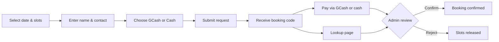

# PickASlot

A custom pickleball court booking system built for **Villa del Rio, Babag II, Lapu-Lapu City, Cebu**. PickASlot lets subdivision homeowners and visitors reserve court time online, pay via GCash or cash, and receive confirmation once an admin verifies payment.

---

## Overview

PickASlot replaces informal sign-up sheets and chat-based scheduling with a simple, mobile-friendly booking flow. Guests browse hourly slots, submit a reservation request, and receive a unique booking code. Because payment happens outside the app (GCash or cash on-site), every booking stays **pending** until an admin manually confirms it after verifying payment.

The system is designed for a single community court today, with room to grow into multi-court or multi-location support.

---

## Who It's For

| Role | Description |
|------|-------------|
| **Homeowners & visitors** | Browse availability, book one or more hourly slots, and track booking status with a code — no account required. |
| **Court admins** | Sign in via Supabase Auth, review pending requests, confirm or reject bookings after payment, and manage court settings. |

---

## How Booking Works



1. **Browse** — Pick a date and view the hourly slot grid for the court's operating hours.
2. **Reserve** — Select one or more consecutive or non-consecutive slots, then enter full name, contact number, and payment method.
3. **Submit** — The app creates a **pending** booking and generates a code (format: `1234-ABC`, derived from the contact number plus a random suffix).
4. **Pay** — Complete payment using the court's GCash details or pay cash as instructed on the confirmation screen.
5. **Confirm** — An admin verifies payment and confirms the booking. Until then, slots are held as pending and visible to others as unavailable.
6. **Track** — Use the **Find Booking** page (`/lookup`) with the booking code to check status: pending, confirmed, or rejected.

---

## Features

### Public (no login)

- **Book** (`/`) — Date picker, live slot availability grid, multi-slot selection, court info (hours, rate, house rules, payment instructions)
- **Find Booking** (`/lookup`) — Look up any reservation by booking code; supports deep links via `?code=XXXX-XXX`
- **Imminent-slot warning** — Prompts users when a selected slot starts within 60 minutes
- **Booking confirmation** — Full-screen success view with copyable booking code and slot summary

### Admin (Supabase Auth + `is_admin` profile)

- **Overview** (`/admin`) — Dashboard entry point
- **Bookings** (`/admin/bookings`) — List, filter, confirm, or reject pending requests
- **Schedule** (`/admin/schedule`) — Court schedule view (planned)
- **Court Settings** (`/admin/settings`) — Hours, pricing, house rules, payment instructions (planned)

Admin routes are protected server-side. Only users with `profiles.is_admin = true` can access them.

---

## Booking Statuses

| Status | Meaning |
|--------|---------|
| **Pending** | Request submitted; awaiting admin confirmation after payment. |
| **Confirmed** | Admin verified payment; slot is reserved. |
| **Rejected** | Admin declined the request; slots are released for others. |

---

## Tech Stack

| Layer | Technology |
|-------|------------|
| Framework | [Next.js 16](https://nextjs.org) (App Router) |
| UI | React 19, Tailwind CSS 4 |
| Database | PostgreSQL (via Supabase) |
| ORM | TypeORM |
| Auth | Supabase Auth (admin only) |
| Business logic | PostgreSQL functions (`create_booking_request`, `lookup_booking_by_code`, `get_day_availability`) |

---

## Project Structure

```
src/
├── app/
│   ├── (public)/          # Guest-facing pages: Book, Find Booking
│   ├── (admin)/admin/     # Protected admin area
│   ├── api/               # REST API routes
│   └── auth/              # Supabase auth callback
├── components/
│   ├── booking/           # Slot grid, date picker, booking sheet, confirmation
│   ├── lookup/            # Booking lookup form and result cards
│   └── shared/            # Nav, form fields, payment buttons
├── hooks/                 # Court, booking submit, lookup hooks
├── lib/
│   ├── bookings/          # Availability helpers, validation, formatting
│   ├── date/              # Calendar, timezone, date-key utilities
│   ├── db/                # TypeORM entities and data source
│   └── supabase/          # Server, browser, and admin Supabase clients
├── services/
│   ├── bookings/          # Public booking service
│   ├── admin/             # Admin auth and booking management
│   └── courts/            # Court data service
└── types/                 # Shared TypeScript types

supabase/
└── migrations/            # Schema, RLS policies, and SQL functions
```

---

## API Routes

| Method | Route | Description |
|--------|-------|-------------|
| `GET` | `/api/courts/current` | Current court details |
| `GET` | `/api/bookings/availability` | Hourly slot availability for a date |
| `POST` | `/api/bookings` | Create a pending booking request |
| `GET` | `/api/bookings/lookup` | Look up a booking by code |
| `GET` | `/api/admin/bookings` | List bookings (admin) |
| `PATCH` | `/api/admin/bookings/[bookingId]` | Confirm or reject a booking |
| `PATCH` | `/api/admin/courts/[courtId]` | Update court settings (admin) |

---

## Database

Core tables:

- **`courts`** — Court name, location, timezone, hours, hourly rate, house rules, payment instructions
- **`bookings`** — Reservation header: code, guest info, payment method, status, cost snapshot
- **`booking_slots`** — Individual one-hour slots tied to a booking
- **`profiles`** — Linked to Supabase Auth users; `is_admin` flag gates admin access

Slot conflicts are prevented by a unique partial index on `(court_id, slot_start_at)` for active (pending or confirmed) slots. Pricing is snapshotted at booking time so rate changes do not affect existing reservations.

Migrations live in `supabase/migrations/`. Apply them through the Supabase CLI or your hosted Supabase project.

---

## Getting Started

### Prerequisites

- Node.js 20+
- A Supabase project with Auth enabled
- PostgreSQL connection string (`DATABASE_URL`)

### Install & run

```bash
npm install
npm run dev
```

Open [http://localhost:3000](http://localhost:3000).

### Environment variables

Create a `.env.local` file:

```env
# Supabase
NEXT_PUBLIC_SUPABASE_URL=
NEXT_PUBLIC_SUPABASE_PUBLISHABLE_KEY=
SUPABASE_SERVICE_ROLE_KEY=

# PostgreSQL (Supabase connection string or direct)
DATABASE_URL=
DATABASE_SSL=true
```

| Variable | Required | Description |
|----------|----------|-------------|
| `NEXT_PUBLIC_SUPABASE_URL` | Yes | Supabase project URL |
| `NEXT_PUBLIC_SUPABASE_PUBLISHABLE_KEY` | Yes | Supabase anon/publishable key |
| `SUPABASE_SERVICE_ROLE_KEY` | Admin ops | Service role key for server-side admin tasks |
| `DATABASE_URL` | Yes | PostgreSQL connection string |
| `DATABASE_SSL` | No | Set to `false` for local Postgres without SSL (default: enabled) |

### Database setup

1. Link your Supabase project and run migrations:

   ```bash
   npx supabase db push
   ```

2. The initial migration seeds a default court record. Update it in the database or via admin settings to match Villa del Rio:

   - Court name and location
   - Operating hours and timezone (`Asia/Manila` recommended for Cebu)
   - Hourly rate (stored in centavos, e.g. `15000` = ₱150.00/hr)
   - House rules and GCash payment instructions

3. Promote an admin user by setting `is_admin = true` on their row in `profiles` after they sign up through Supabase Auth.

### Scripts

| Command | Description |
|---------|-------------|
| `npm run dev` | Start development server |
| `npm run build` | Production build |
| `npm run start` | Start production server |
| `npm run lint` | Run ESLint |

---

## Design

The UI uses a court-green palette tuned for outdoor/community use. Design tokens and component guidelines are documented in `docs/design/design-system.md`.

Reference HTML prototypes (`book.html`) are kept for visual comparison during development.

---

## Deployment

The app is a standard Next.js application and deploys cleanly to [Vercel](https://vercel.com) or any Node.js host. Set all environment variables in your deployment platform and ensure the Supabase database migrations have been applied.

---

## License

Private — built for Villa del Rio subdivision use.
